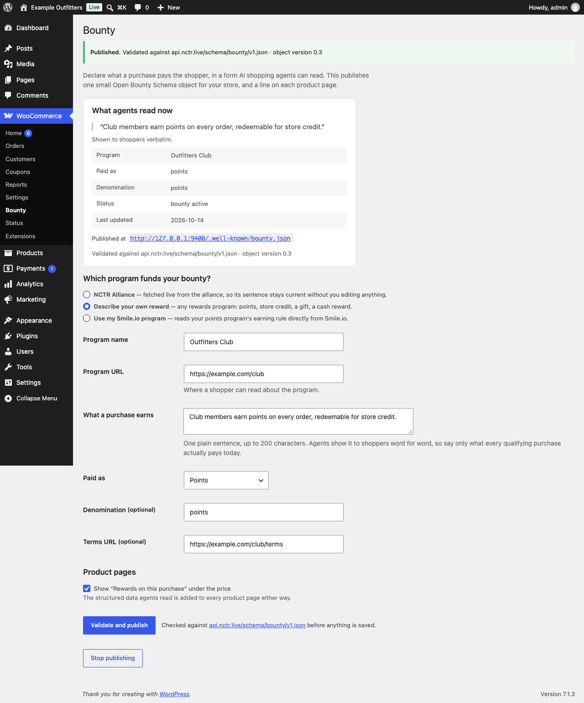
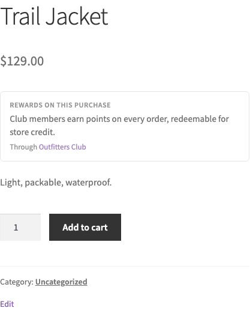

# Open Bounty for WooCommerce

Tell AI shopping agents what a purchase at your store pays the shopper.

When someone asks an AI assistant "where should I buy this?", the assistant can only mention your
rewards if it can read them. This plugin publishes one small, standard description of your reward
(an [Open Bounty Schema](https://github.com/Hoya25/open-bounty-schema) object) where agents look
for it, and adds a short line to each product page so shoppers see the same thing.

---

## What it does

Once you publish, your store carries your reward sentence in four places:

| Where | Who reads it |
|---|---|
| `yourstore.com/.well-known/bounty.json` | Agents. It's the standard address they check first. |
| A `<link rel="bounty">` tag in your pages' `<head>` | Agents that start from your home page. |
| Your product pages' structured data (inside WooCommerce's own product `Offer`) | Agents and search engines reading a product. |
| **Rewards on this purchase**, under the price | Shoppers. You can turn this off. |

Before you publish, none of this exists. Your store looks exactly as it did before you installed the plugin.

## Install

You need WordPress 6.4 or later, WooCommerce 8.0 or later, and PHP 7.4 or later.

1. Download **`open-bounty-1.4.0.zip`** from the
   [Releases page](https://github.com/Hoya25/bounty-woocommerce/releases). Don't unzip it.
2. In WordPress, go to **Plugins → Add New Plugin → Upload Plugin**, choose the zip, and click
   **Install Now**, then **Activate**.
3. Go to **WooCommerce → Bounty**.

## Set it up

Choose **which program funds your bounty**:

- **NCTR Alliance**: pick this only if your store is connected to the NCTR Alliance, so purchases
  here really do earn through it. Tick the confirmation box. The plugin fetches the alliance's own
  description and keeps it current by itself, so there's nothing to type.
- **Describe your own reward**: for any other program. Fill in:
  - **Program name**, e.g. *Outfitters Club*
  - **Program URL**: the page where a shopper can read about it
  - **What a purchase earns**: one plain sentence, up to 200 characters. Agents repeat it to
    shoppers **word for word**, so write only what every qualifying purchase actually pays today.
  - **Paid as**: points, token, cash, or other (store credit, a gift, …)
  - **Denomination** and **Terms URL** are optional.
- **Use my Smile.io program**: if your store runs Smile.io, the plugin reads your points
  program's earning rule from Smile.io and writes the sentence for you, for example:
  *"Members earn 1 Point per dollar, redeemable at checkout."* You only choose whether it says
  *Members* or *Customers*. The number and the points name come from Smile.io and can't be
  typed. If Smile.io can't be read, or your program is switched off, pays a fixed amount per
  order instead of per dollar, isn't in dollars, or has no rewards to spend points on, the page
  tells you which, and nothing is published.

  **Good to know:** Smile.io officially supports Shopify and BigCommerce, not WooCommerce. On
  most WooCommerce stores this option will tell you no Smile.io program was found. That's the
  honest answer, not an error.
- **Use my Yotpo Loyalty program**: the same idea for Yotpo Loyalty & Referrals. The plugin reads
  your store-wide points-for-purchases campaign from the Yotpo loyalty script on your pages
  (product-specific bonus campaigns are ignored), and writes the sentence for you. It refuses,
  and says why, in the same cases as Smile.io, and also if your VIP tiers multiply every
  member's rate or your points have no single name.

  **Good to know:** Yotpo says it doesn't currently support new WooCommerce accounts, and its
  support pages don't list WooCommerce as a supported platform. If your store has an existing
  or custom Yotpo Loyalty install that loads Yotpo's script on your pages, this option reads it.

- **Use my LoyaltyLion program**: the same for LoyaltyLion. The plugin reads your purchase rule
  at your entry tier, your points name (singular and plural, as LoyaltyLion shows them), and
  whether your program is switched on, and writes the sentence for you. It refuses, and says why,
  in the same cases as the others, and also if your purchase rule only pays a limited number of
  times.

  **Good to know:** LoyaltyLion lists Shopify, Adobe Commerce and custom platforms as install
  targets, not WooCommerce. A custom install that loads LoyaltyLion's script on your pages can be
  read.

Then click **Validate and publish**.

The plugin checks your description against the published standard before saving anything. If
something's wrong, you'll see a red **Nothing was published** box listing what to fix, and nothing
changes on your store. When it succeeds you'll see **Published**, the standard version it was
checked against, and the address where agents can now read it.

### Your sentence is yours

When you describe your own reward, the plugin publishes your sentence exactly as you wrote it.
It only checks that it's present, one sentence of at most 200 characters, and that the
program name and URL are filled in. Write what every qualifying purchase actually pays, because
agents repeat it to shoppers word for word.

(The **NCTR Alliance** option is different: that sentence is the alliance's, and it's published
only if it meets the alliance's own wording rules.)

## Check that it worked

- Open `https://yourstore.com/.well-known/bounty.json` in a browser. You should see your
  description as plain text, starting with `{`.
- Open any product. Under the price you should see **Rewards on this purchase** with your sentence.
  If you turned the line off, it won't be there, but the structured data still is.

If the `.well-known` address shows your theme's "page not found" after you've published:

1. Go to **Settings → Permalinks** and click **Save Changes** once. This refreshes WordPress's
   address rules.
2. Make sure your permalinks are set to anything other than **Plain**.
3. Some hosts reserve `/.well-known/` for their own use, for example for security certificates.
   If yours does, agents can still find your description through the `<link rel="bounty">` tag,
   and you can ask your host to pass `/.well-known/bounty.json` through to WordPress.

## Stop publishing

**WooCommerce → Bounty → Stop publishing** takes everything down at once: the address returns
"not found", and product pages lose the line and the structured data. Deactivating or deleting the
plugin does the same. Deleting it also removes its settings.

## Privacy

The plugin stores your settings in your own WordPress database. It makes outgoing requests only
to `api.nctr.live`: to fetch the published standard it checks against (once every 10 minutes at
most), and, only if you chose NCTR Alliance, to fetch the alliance's description. It never reads
your orders or customers, and it sends nothing about your store or your shoppers anywhere.

---

## For developers

- Spec: [Open Bounty Schema](https://github.com/Hoya25/open-bounty-schema). The plugin publishes
  v0.3 objects and validates against the stable alias
  `https://api.nctr.live/schema/bounty/v1.json`, which it caches for 10 minutes.
- Unit tests: `sh bin/test.sh` (PHPUnit; it fetches the phar on first run). The disclosure gate
  runs over every rendered surface.
- Local site: `npm install && npm run site` starts WordPress + WooCommerce on
  `http://127.0.0.1:9400` via WordPress Playground (login `admin` / `password`).
- End-to-end: `npm run e2e`, with the site running. It drives the settings form and checks the
  well-known object, the headers, the head link, the JSON-LD, the block (in classic and block
  themes), and a spec §4 discovery walk.
- Release zip: `sh bin/build-zip.sh` writes `build/open-bounty-<version>.zip`.

License: MIT.
